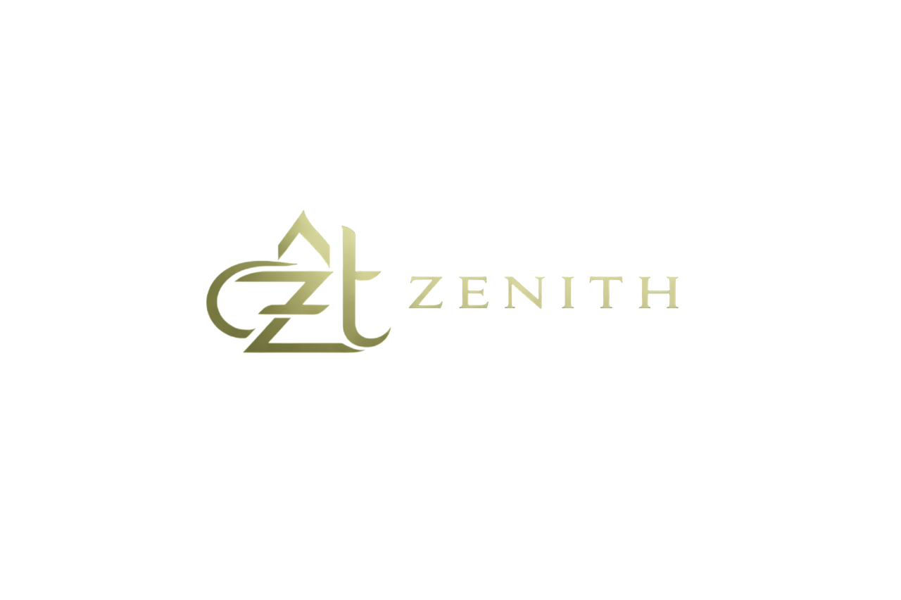

# Zenith | Cinematic Essentials

<p align="center">
  
</p>

<p align="center">
  A cinematic e-commerce experience built around minimal design, curated collections, and seamless shopping functionality.
</p>

---

## Overview

**Zenith** is a full-stack e-commerce marketplace featuring a minimalist storefront and a dedicated administrative dashboard.

The frontend is built using HTML, CSS, and Vanilla JavaScript with ES6 modules. It communicates with a separate Java Spring Boot backend through REST APIs.

The interface follows a cinematic, archival-inspired visual direction, combining dark backgrounds, subtle animations, and elegant typography.

## Features

### Storefront
- Cinematic homepage and product collections.
- Product listings and detailed product pages.
- Product search functionality.
- Responsive navigation.
- About and informational pages.

### User Authentication
- User registration and login.
- JWT-based authentication.
- Session handling using browser local storage.
- Automatic handling of expired authentication sessions.
- User profile management.

### Shopping Cart
- Add products to the cart.
- View cart items and quantities.
- Remove products from the cart.
- Dynamic cart count updates.
- Cart synchronization with the backend.

### Checkout & Payments
- Dedicated checkout interface.
- Shipping information collection.
- Razorpay payment integration.
- Credit/debit card and UPI payment options through Razorpay.
- Cash on Delivery option.
- Payment verification through the backend.
- Order confirmation screen.

### Customer Account
- View profile information.
- Access order history.
- Track order information.
- Manage account sessions.

### Admin / Seller Dashboard
- Dashboard overview and statistics.
- Inventory management.
- Product addition and deletion.
- Order management.
- Order fulfillment status updates.
- Administrative access based on user roles.

### Additional Pages
- About / The Heritage.
- Search results.
- Order success.
- Order tracking.
- Shipping and returns information.
- Privacy policy.
- Terms of service.
- Contact information.

## Technology Stack

### Frontend

| Technology | Purpose |
|---|---|
| HTML5 | Application structure |
| CSS3 | Styling and responsive layouts |
| JavaScript (ES6+) | Application logic |
| Tailwind CSS CDN | Utility-based styling |
| Razorpay Checkout SDK | Payment interface |
| Chart.js | Dashboard chart functionality |
| Google Fonts | Typography |

### Backend Integration

| Technology | Purpose |
|---|---|
| Java 17 | Backend language |
| Spring Boot | REST API framework |
| Spring Security | Authentication and authorization |
| JWT | Token-based authentication |
| Spring Data JPA | Database access |
| MySQL | Data persistence |
| Cloudinary | Product image storage |
| Razorpay | Payment processing |

## Architecture

Zenith follows a decoupled frontend-backend architecture.

- The frontend handles the user interface, navigation, interactions, and API communication.
- The backend manages authentication, business logic, database operations, product management, orders, and payment verification.
- The two repositories communicate through REST APIs.

## Project Structure

```text
zenith-frontend/
│
├── assets/
│   ├── logo-navbar.png
│   ├── logo-favicon.png
│   └── products/
│
├── css/
│   └── style.css
│
├── js/
│   ├── api.js
│   ├── app.js
│   └── cart.js
│
├── pages/
│   ├── about.js
│   ├── admin.js
│   ├── auth.js
│   ├── cart.js
│   ├── checkout.js
│   ├── home.js
│   ├── legal.js
│   ├── orderSuccess.js
│   ├── product.js
│   ├── profile.js
│   ├── search.js
│   ├── sellerDashboard.js
│   ├── shop.js
│   └── trackOrder.js
│
└── index.html
```

## Getting Started

### Prerequisites

- A modern web browser.
- Git.
- A local static web server, such as VS Code Live Server.
- The Zenith backend running locally or accessible through its deployed API.

### 1. Clone the Repository

```bash
git clone https://github.com/Ishaan-2589/zenith-frontend.git
cd zenith-frontend
```

### 2. Configure the Backend URL

Open:

```text
js/api.js
```

The application already switches between the local backend and deployed backend based on the hostname.

```javascript
const isLocalhost =
  window.location.hostname === "localhost" ||
  window.location.hostname === "127.0.0.1";

const API_BASE_URL = isLocalhost
  ? "http://localhost:8080/api"
  : "https://zenith-backend-inch.onrender.com/api";
```

For local development, ensure the backend is running on port `8080`.

### 3. Run the Frontend

You can use the VS Code Live Server extension:

1. Open the project folder in VS Code.
2. Open `index.html`.
3. Right-click and select **Open with Live Server**.

Alternatively, use another static HTTP server.

The frontend will be accessible at the local address provided by your server.

## Backend Repository

The frontend requires the separate Zenith backend for authentication, product data, cart operations, order management, and payment processing.

**Backend Repository:**  
[https://github.com/Ishaan-2589/zenith-backend](https://github.com/Ishaan-2589/zenith-backend)

## Deployment

The frontend can be hosted using any static website hosting service.

The current API configuration points non-localhost environments to the deployed Zenith backend hosted on Render.

For a working deployment, ensure:
- The backend service is running.
- Database credentials are configured.
- External service credentials are configured.
- Backend CORS settings permit the frontend origin.
- Razorpay credentials are configured appropriately.

## Future Improvements

- Expanded mobile and responsive refinements.
- Customer reviews and ratings.
- Enhanced product filtering.
- Improved order tracking.
- Additional storefront and dashboard functionality.

---

**Zenith — Cinematic Essentials.**
